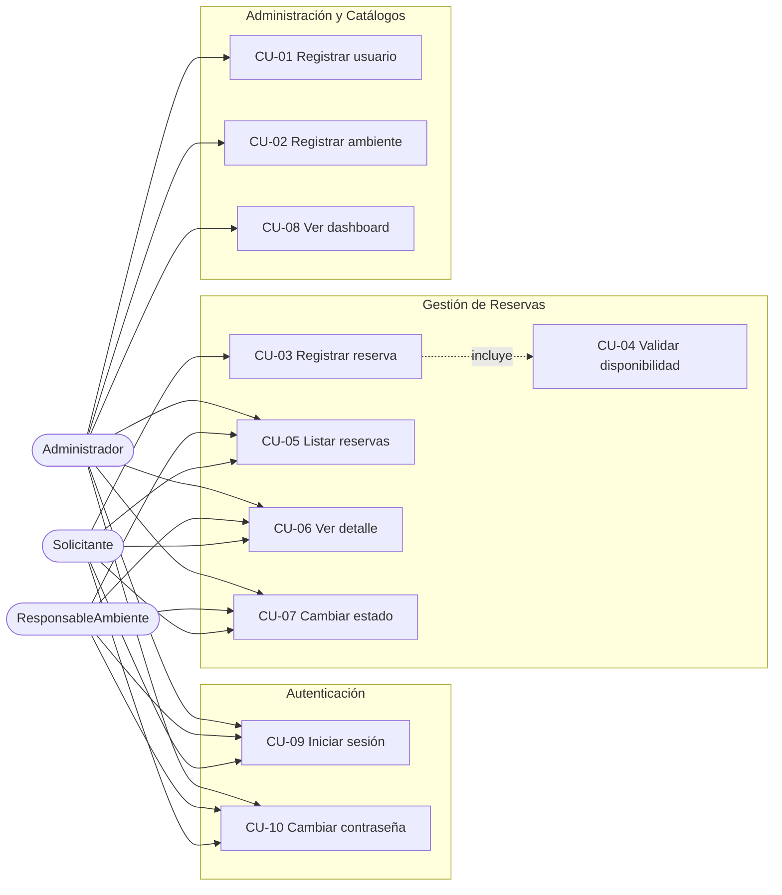
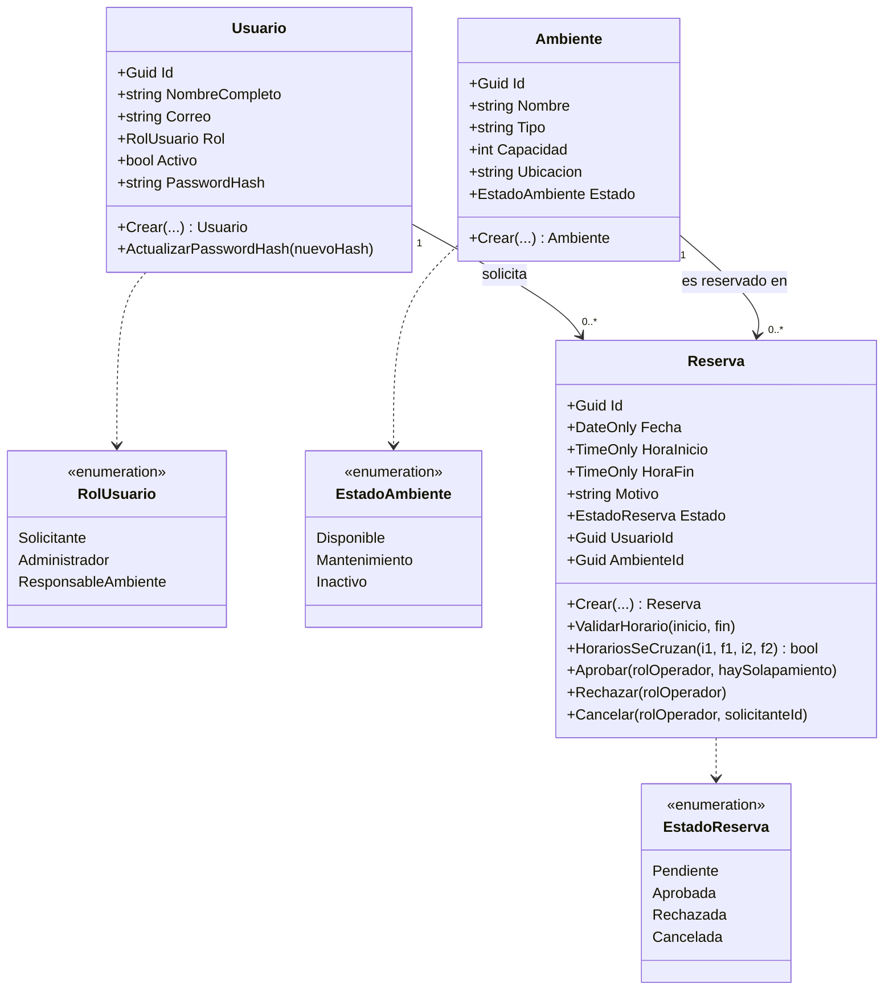
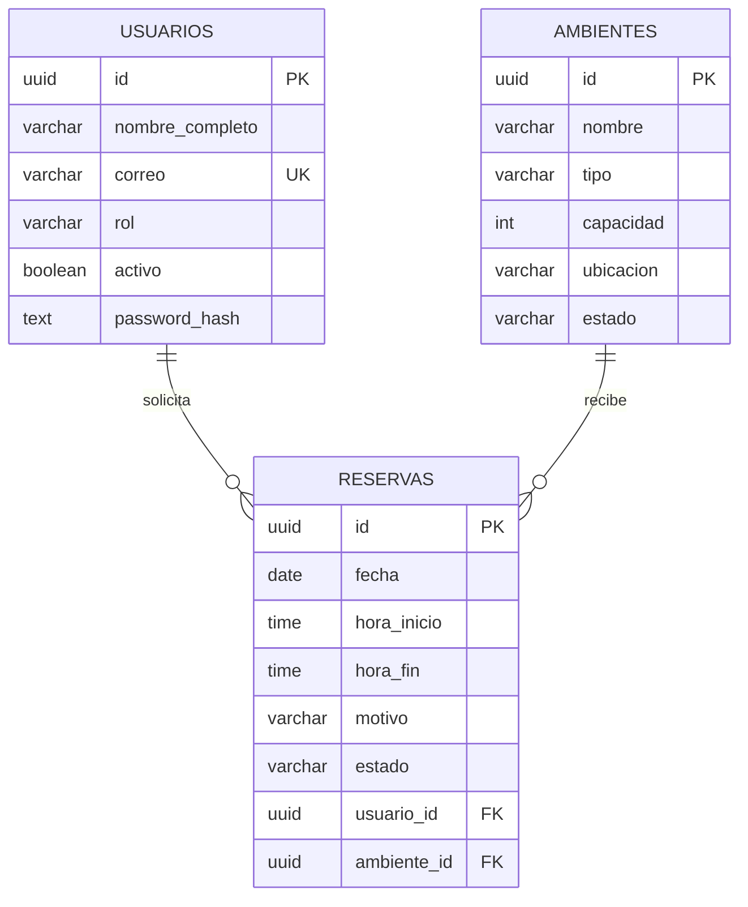
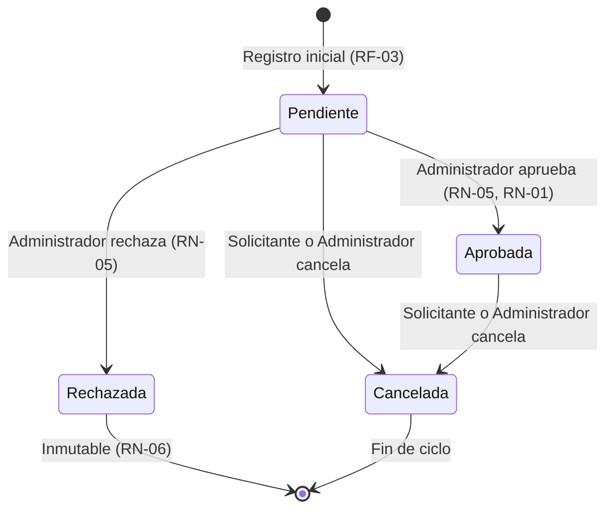
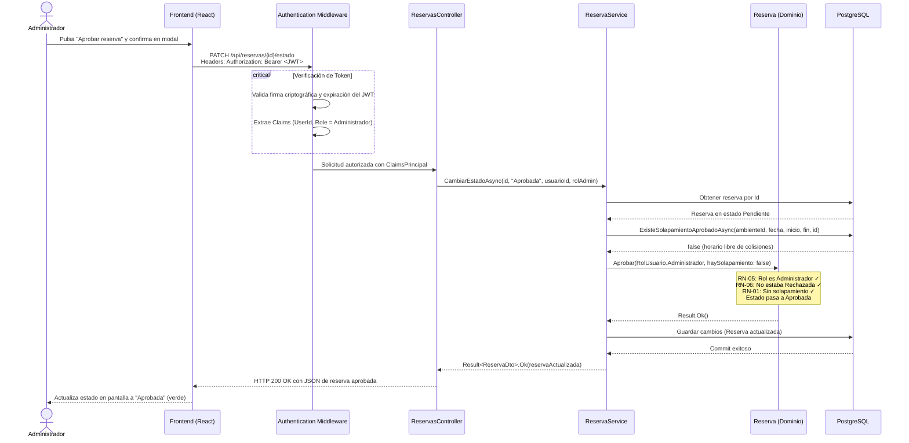

# S01 — Análisis del sistema ReservaUPLA

Documento de análisis de requisitos, actores, casos de uso, reglas de negocio y arquitectura del sistema **ReservaUPLA**.

---

## 1. Problema y alcance

La universidad necesita gestionar y ordenar el uso compartido de sus ambientes físicos (aulas, laboratorios y auditorios), evitando conflictos de horario y garantizando que ningún ambiente sea ocupado simultáneamente por dos grupos distintos.

- **Dentro del alcance:**
  - Gestión y autenticación de usuarios mediante credenciales y tokens JWT (CU-09, CU-10).
  - Catálogo de usuarios y ambientes universitarios (RF-01, RF-02).
  - Registro de solicitudes de reserva de ambientes con validación estricta de horarios (RF-03, RF-04).
  - Consulta de reservas y filtrado con aislamiento por rol (RF-05, RF-06).
  - Aprobación, rechazo y cancelación de reservas bajo reglas de negocio RN-01 a RN-06 (RF-07).
  - Panel analítico (Dashboard) con métricas consolidadas para la administración (RF-08).
  - Modo visual dual (claro y oscuro) con accesibilidad web.
- **Fuera del alcance:**
  - Cobros o pagos por reserva.
  - Envío de notificaciones por correo electrónico o SMS.
  - Registro público de usuarios (auto-registro).
  - Recuperación de contraseñas por enlace externo o integración con OAuth/SAML institucional.

---

## 2. Actores del sistema

| Actor | Descripción y responsabilidades |
|---|---|
| **Solicitante** | Docente, estudiante o personal administrativo que requiere un ambiente. Inicia sesión, solicita reservas a su nombre, consulta únicamente sus propias reservas y puede cancelar sus reservas pendientes o aprobadas. |
| **ResponsableAmbiente** | Encargado o custodio físico de los ambientes (laboratorista, personal de mantenimiento). Consulta el calendario general de reservas y la lista de ambientes para la apertura de puertas y supervisión operativa. |
| **Administrador** | Responsable de la gestión académica de espacios. Aprueba o rechaza solicitudes (RN-05), registra nuevos ambientes y usuarios, cancela cualquier reserva y analiza los indicadores del dashboard. |

---

## 3. Casos de uso

| Código | Caso de uso | Actor principal | Requisito / Regla | Descripción resumida |
|---|---|---|---|---|
| **CU-01** | Registrar usuario | Administrador | RF-01, RN-02 | Registra un nuevo usuario asignándole rol y contraseña inicial con hash. |
| **CU-02** | Registrar ambiente | Administrador | RF-02, RN-02 | Registra aulas, laboratorios o auditorios con su capacidad y ubicación. |
| **CU-03** | Registrar reserva | Solicitante | RF-03, RN-01..RN-04 | Crea una solicitud en estado Pendiente validando rango horario y disponibilidad. |
| **CU-04** | Validar disponibilidad | Solicitante | RF-04, RN-01 | Comprueba en tiempo real si un horario está libre de cruces con reservas aprobadas. |
| **CU-05** | Listar reservas | Todos | RF-05 | Administrador y Responsable ven todas; Solicitante ve solo sus propias reservas. |
| **CU-06** | Ver detalle de reserva | Todos | RF-06 | Muestra datos completos. Si un Solicitante consulta una ajena, recibe 404. |
| **CU-07** | Cambiar estado de reserva | Administrador / Usuario | RF-07, RN-01, RN-05, RN-06 | Administrador aprueba o rechaza. El Solicitante cancela solo las suyas; Responsable y Administrador, cualquiera. |
| **CU-08** | Ver dashboard | Administrador | RF-08 | Visualiza totales, ranking de ambientes más utilizados y reservas por fecha. |
| **CU-09** | Iniciar sesión | Todos | LOGIN, RN-02 | Autenticación con correo y contraseña para obtener un token JWT con claims. |
| **CU-10** | Cambiar contraseña | Todos autenticados | LOGIN, RN-02 | Permite al usuario actualizar su contraseña validando la actual y complejidad. |

---

## 4. Matriz Requisito ↔ Reglas de Negocio ↔ Entidades

| Requisito / Caso de Uso | Reglas de Negocio | Entidades involucradas | Mecanismo de validación |
|---|---|---|---|
| **CU-09 Iniciar sesión** | RN-02 (campos obligatorios) | `Usuario` | Verificación de hash PBKDF2 y comprobación de cuenta activa (`Activo = true`). |
| **CU-10 Cambiar contraseña** | RN-02, Complejidad mínima (8 chars, letra y número) | `Usuario` | Verificación de contraseña actual con hash y derivación de nueva clave. |
| **CU-01 Registrar usuario** | RN-02, Correo único | `Usuario` | Validación de formato, unicidad en BD y hasheo de contraseña inicial. |
| **CU-02 Registrar ambiente** | RN-02, Capacidad > 0 | `Ambiente` | Restricción de dominio y check en base de datos. |
| **CU-03 Registrar reserva** | RN-01, RN-02, RN-03, RN-04 | `Reserva`, `Usuario`, `Ambiente` | Verificación de horarios 07:00 a 22:00, fin > inicio, ambiente disponible y usuario activo. |
| **CU-04 Validar disponibilidad** | RN-01, RN-03, RN-04 | `Reserva`, `Ambiente` | Algoritmo de traslape en repositorio contra reservas en estado Aprobada. |
| **CU-05 Listar reservas** | Aislamiento por rol | `Reserva` | Filtro LINQ: Solicitante consulta `r.UsuarioId == usuarioActualId`. |
| **CU-06 Ver detalle** | Aislamiento por rol | `Reserva`, `Usuario`, `Ambiente` | Respuesta 404 NotFound si el recurso no pertenece al Solicitante autenticado. |
| **CU-07 Cambiar estado** | RN-01, RN-05, RN-06 | `Reserva` | Solo Administrador aprueba/rechaza (RN-05). Una reserva Rechazada es inmutable (RN-06). Cancelar: el Solicitante solo las suyas; Responsable y Administrador, cualquiera. |
| **CU-08 Dashboard** | Integración de métricas | `Reserva`, `Ambiente` | Agregación de conteos por estado, reservas aprobadas por ambiente y distribución cronológica. |

---

## 5. Modelo de clases de Dominio

---

## 6. Modelo de Base de Datos (Entidad-Relación)

---

## 7. Ciclo de vida y estados de una reserva

---

## 8. Diagrama de secuencia: Flujo de aprobación con JWT (RN-05, RN-01)

El siguiente diagrama ilustra el flujo seguro de aprobación donde las credenciales son verificadas a través de un token JWT firmado criptográficamente, garantizando la identidad y el rol de Administrador antes de ejecutar las reglas de dominio:

---

## 9. Matriz de gestión de riesgos técnicos

| Riesgo identificado | Severidad | Mitigación implementada |
|---|:---:|---|
| **Falsificación de identidad o roles** | Alta | Firma criptográfica simétrica HMAC-SHA256 con clave secreta fuera del código fuente (`user-secrets`). |
| **Ataque de fuerza bruta o diccionario a contraseñas** | Alta | Algoritmo PBKDF2 con sal aleatoria de 128 bits y 100,000 iteraciones; hashes únicos para cada usuario. |
| **Fuga de datos entre solicitantes (IDOR)** | Alta | Validación estricta en repositorio y controladores: reservas ajenas responden 404 impidiendo enumeración de IDs. |
| **Condición de carrera en reservas simultáneas** | Media | Doble validación: comprobación previa en servicio y regla de dominio; soporte para índice EXCLUDE opcional en BD. |
| **Exposición accidental de credenciales en Git** | Alta | Exclusión de `appsettings.Development.json` y variables locales mediante `.gitignore`; uso estricto de secretos de desarrollo. |
