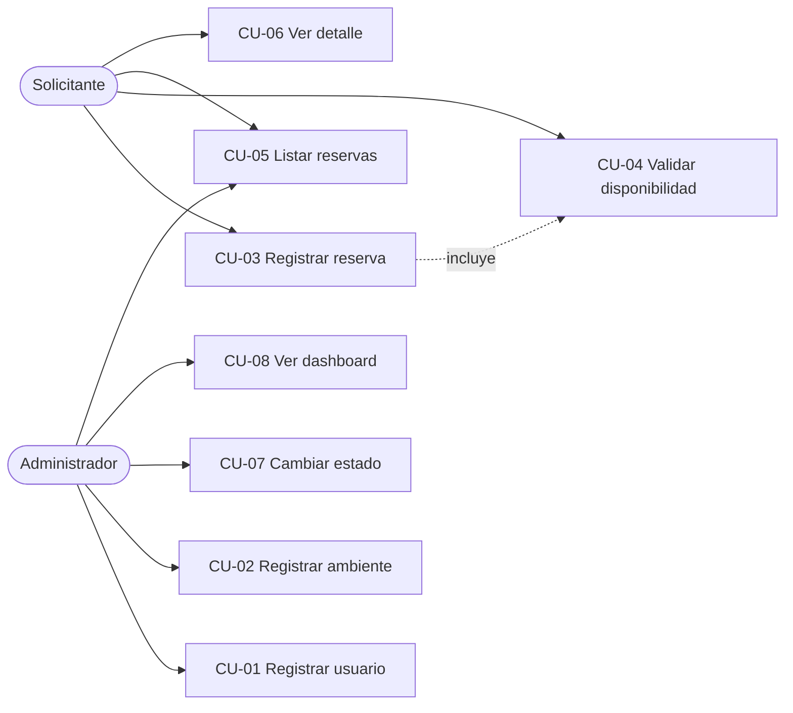
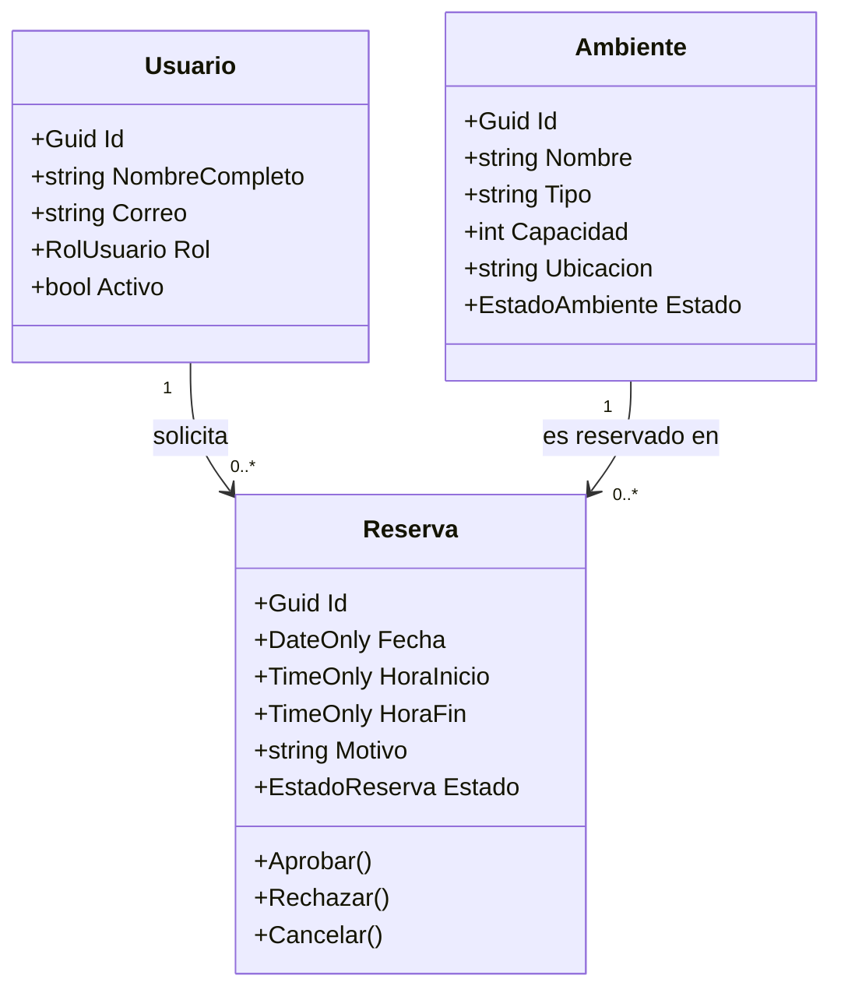
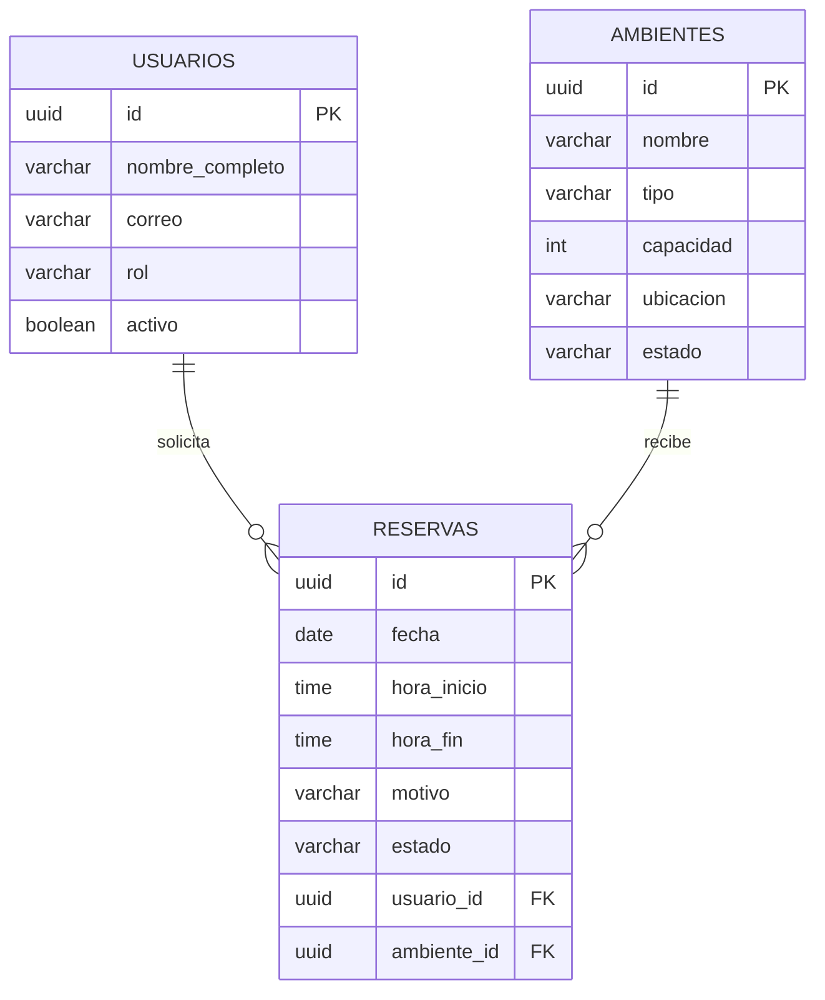
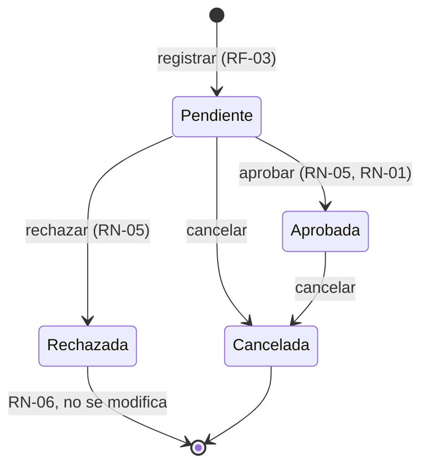
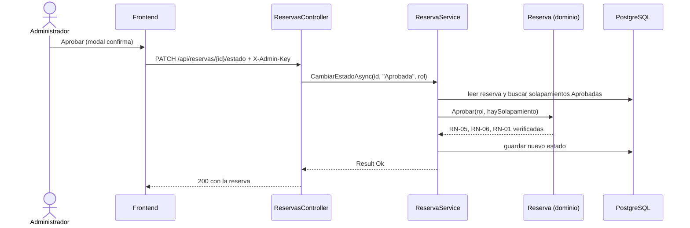

# S01 — Análisis del sistema ReservaUPLA (borrador)

> Borrador para que lo reescribas con tus palabras. Los diagramas están en Mermaid (se ven en GitHub, VS Code con extensión Mermaid o <https://mermaid.live>).

## 1. Problema y alcance

La universidad necesita ordenar quién usa cada ambiente (aula, laboratorio, auditorio) y cuándo, evitando que dos grupos ocupen el mismo lugar a la misma hora. **Dentro del alcance:** RF-01 a RF-08. **Fuera del alcance:** pagos, envío de correos, roles adicionales, login completo.

## 2. Actores

| Actor | Qué hace en el sistema |
|---|---|
| Solicitante | Pide reservas y consulta su estado |
| Administrador | Aprueba o rechaza reservas, registra usuarios y ambientes, consulta el dashboard (RN-05) |
| ResponsableAmbiente | Rol registrado en el sistema, sin permisos especiales de aprobación **[SUPUESTO]** |

## 3. Casos de uso

| Código | Caso de uso | Actor principal | Requisito |
|---|---|---|---|
| CU-01 | Registrar usuario | Administrador | RF-01 |
| CU-02 | Registrar ambiente | Administrador | RF-02 |
| CU-03 | Registrar reserva | Solicitante | RF-03 |
| CU-04 | Validar disponibilidad | Solicitante | RF-04 |
| CU-05 | Listar reservas | Todos | RF-05 |
| CU-06 | Ver detalle de reserva | Todos | RF-06 |
| CU-07 | Cambiar estado de reserva | Administrador (aprobar/rechazar), todos (cancelar) | RF-07 |
| CU-08 | Ver dashboard | Administrador | RF-08 |

## 4. Matriz RF ↔ RN ↔ entidad

| Requisito | Reglas relacionadas | Entidades |
|---|---|---|
| RF-01 Registrar usuarios | RN-02 | Usuario |
| RF-02 Registrar ambientes | RN-02 | Ambiente |
| RF-03 Registrar reservas | RN-01, RN-02, RN-03, RN-04 | Reserva, Usuario, Ambiente |
| RF-04 Validar disponibilidad | RN-01, RN-03, RN-04 | Reserva, Ambiente |
| RF-05 Listar reservas | — | Reserva |
| RF-06 Ver detalle | — | Reserva, Usuario, Ambiente |
| RF-07 Cambiar estado | RN-01, RN-05, RN-06 | Reserva |
| RF-08 Dashboard | — | Reserva, Ambiente |

## 5. Modelo de clases

## 6. Base de datos (entidad-relación)

## 7. Estados de una reserva

## 8. Flujo principal: aprobar una reserva

## 9. Riesgos

| Riesgo | Probabilidad | Impacto | Qué hago |
|---|---|---|---|
| Un solo desarrollador, poco tiempo | Alta | Alto | Alcance fijo, entregas semanales, no agregar funciones extra |
| Dos aprobaciones al mismo tiempo que se crucen | Baja | Medio | Validar en el servicio y, opcionalmente, restricción de exclusión en la BD (comentada en `01_init.sql`) |
| Subir secretos al repositorio por error | Media | Alto | `user-secrets`, `.gitignore`, `appsettings.Example.json`, revisar `git status` |
| Incompatibilidad de versiones EF Core / Npgsql | Media | Medio | Usar ambas en 8.x |
| Perder el control del alcance | Media | Medio | Matriz RF↔RN y plan de commits |

## 10. Supuestos

Ver la lista **[SUPUESTO]** del README: estados permitidos para cada cambio, ambiente y usuario deben estar habilitados, correo único, «más utilizado» = más reservas Aprobadas, autenticación por clave de administrador.

## 11. Qué fuentes citar (tú las buscas y las citas en el texto)

- Libro de ingeniería de software sobre **requisitos y casos de uso** (por ejemplo Sommerville o Pressman).
- Texto sobre **UML**: diagramas de casos de uso, clases y estados (Fowler, «UML Distilled»).
- Documento sobre **Clean Architecture** (Robert C. Martin).
- **Heurísticas de usabilidad de Nielsen** (sitio de Nielsen Norman Group).
- Documentación oficial de **.NET, EF Core, Npgsql y PostgreSQL** para las decisiones técnicas.

Verifica edición, año y editorial antes de poner cada referencia.
